# Zoom RTMS setup record

Status: real Zoom transcript capture demonstrated on October 16, 2026. A meeting hosted from the user's other computer sent actual speech through Zoom RTMS, the temporary tunnel, and the recorder into the web application's live call view. The local prototype originally used simulated viewer accounts. The Fly deployment below uses a real password session limited to the configured Tyler account; Google OAuth remains pending.

## Demo scope and later promise

The first delivery is live text transcripts and public chat. Audio was initially deferred as a later promise; the user subsequently expressed interest in audio, camera video and screen-share capture after text works. At wrap-up the user accepted the transcript test and turned to deployment/storage discussion, so those media additions remain unimplemented and unproved. Runtime media stays `transcript,chat`. Zoom automatically adds `meeting:read:meeting_audio` as a required dependency of the transcript scope; that permission does not mean this recorder is capturing audio.

## Prerequisites

- Zoom Pro or higher and Developer Pack (user reports both purchased).
- Sign into Zoom Marketplace with the same intended Zoom account.
- A local build of `cmd/rtmsrec` and an HTTPS tunnel to its webhook listener.

## 1. Enter the developer portal

In Safari, open https://marketplace.zoom.us/user/build. The existing session is signed in. On first entry, Zoom presents its Marketplace Terms of Use. The user must approve acceptance before the agent clicks **Agree**.

Completed: the user explicitly approved, **Agree** was clicked, and the signed-in **Created apps** dashboard appeared with no apps.

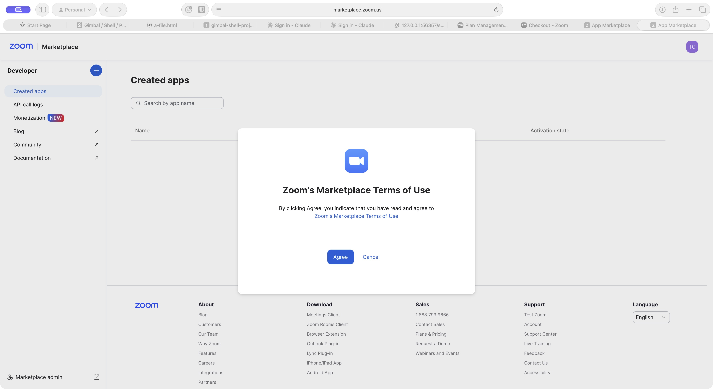

## 2. Start app creation

Click the **Add** button beside **Developer**, then **Build app**. On this account, Zoom presents a second, separate **API License and Terms of Use** agreement before the app-type form. The user explicitly approved this agreement and it was accepted.

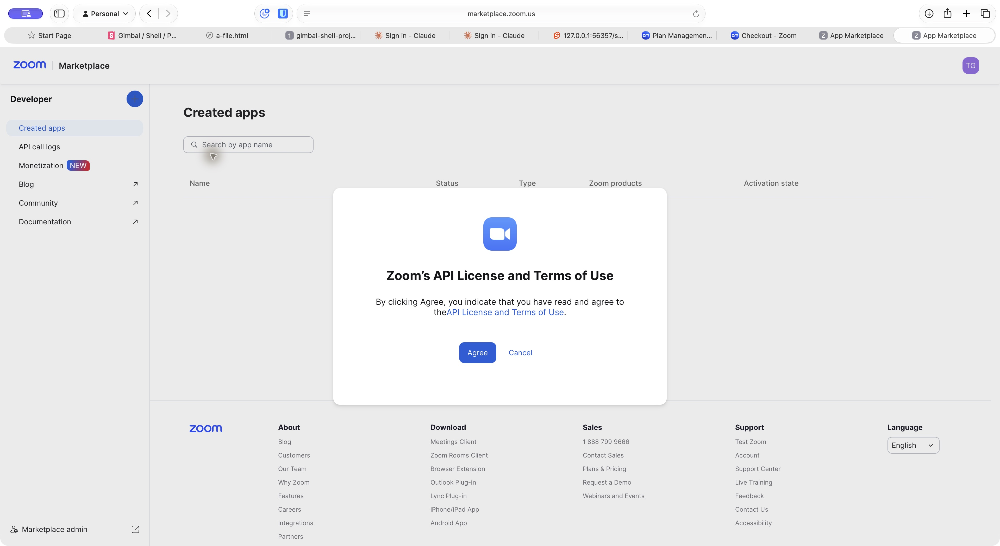

## 3. Create the app and set scopes

Choose **General App**, click **Create**, keep **User-managed**, and rename it **Zoom Connect Demo**. Under **Scopes → Add Scopes**, search `meeting_transcript`, choose **Meetings**, then select `meeting:read:meeting_transcript`. Zoom adds `meeting:read:meeting_audio` automatically. Add `meeting:read:meeting_chat` and click **Done**.

Under **Surface**, select **Meetings**. This enables the RTMS auto-start controls under **Access**.

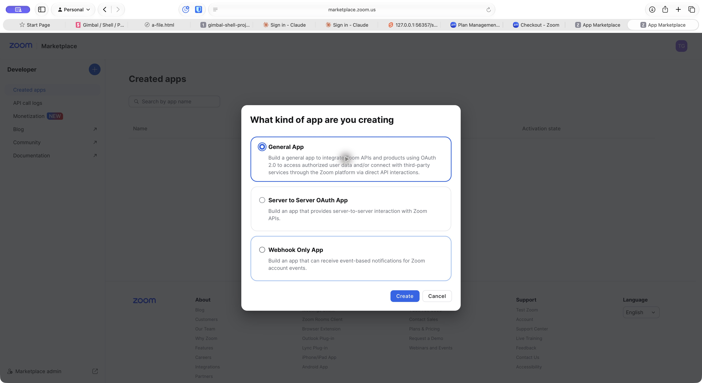
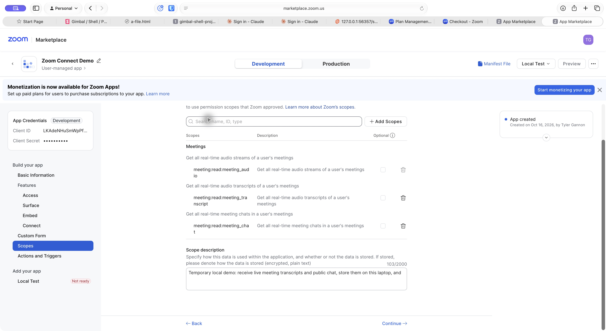

## 4. Local credentials, recorder and tunnel

Copy the development Client ID and Client Secret from **Basic Information**, and the Secret Token from **Access**, into the ignored `.env` file. Keep its permissions at `0600`. No secrets belong in this guide or its screenshots.

The web app listens on `127.0.0.1:8080`, the recorder on `127.0.0.1:8081`. The database for this run is `zoom_connect_live_demo`, separate from the original demo database. Start the web app with its environment loaded:

```sh
set -a
source .env
set +a
./bin/zoom-connect
```

Sign into the web app as Dana Kim, the prototype admin, and create a local API key for the recorder. Set `ZOOM_CONNECT_URL=http://127.0.0.1:8080` and `ZOOM_CONNECT_KEY` to that key in `.env`. This selects the prototype viewer who can see the real call; it does not establish real Google identity or Zoom-participant email matching.

In a second terminal, load the same environment and run:

```sh
./ephemeral/bin/rtmsrec
```

In a third terminal:

```sh
cloudflared tunnel --config /dev/null --url http://127.0.0.1:8081 --no-autoupdate
```

The explicit config override matters on this machine: its existing Cloudflare config otherwise caused the new public address to return 404 despite a healthy local recorder. The final tunnel's `/healthz` returned `ok` publicly.

Build commands, when needed:

```sh
go build -o bin/zoom-connect ./cmd
go build -o ephemeral/bin/rtmsrec ./cmd/rtmsrec
```

The web binary needs the generated frontend build. This run reused the already-built frontend from the previous app worktree; no frontend source changed. For a fresh checkout, use the project's documented `just build` workflow.

## 5. Webhook and startup configuration

Under **Access**, enable **Event Subscription**, choose **Add New Event Subscription**, name it, and add these **RTMS** events:

- RTMS started in Meeting (`meeting.rtms_started`).
- RTMS stopped in Meeting (`meeting.rtms_stopped`).
- RTMS interrupted in Meeting (`meeting.rtms_interrupted`).

Set the endpoint to `<current-tunnel-origin>/zoom/webhook` and click **Save**. The current development UI saved the endpoint without displaying a separate Validate button. A live, signed RTMS webhook was subsequently delivered successfully. A tunnel restart gives a new hostname: update both the webhook and OAuth URLs afterward.

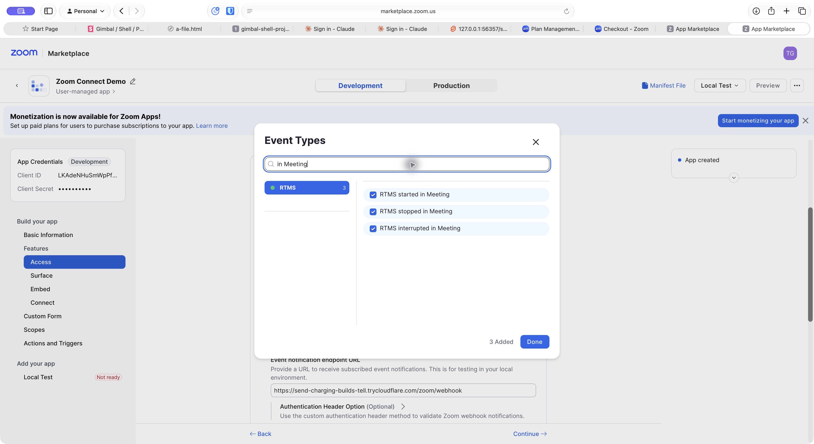

Auto-start defaults were set for meetings the user owns and externally hosted meetings. Under **Basic Information**, set the development OAuth redirect and allow-list URL to `<current-tunnel-origin>/healthz`. This is a test installation callback only; the recorder does not exchange OAuth codes for tokens.

Under **Local Test**, click **Add app now**. Zoom requested a fresh sign-in; the user completed installation. The developer page then showed **Remove App**, confirming installation.

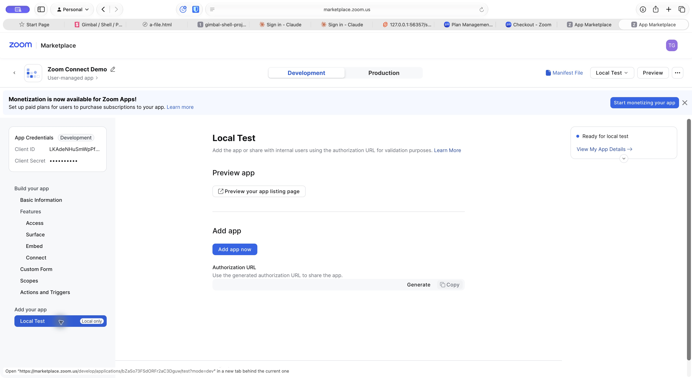
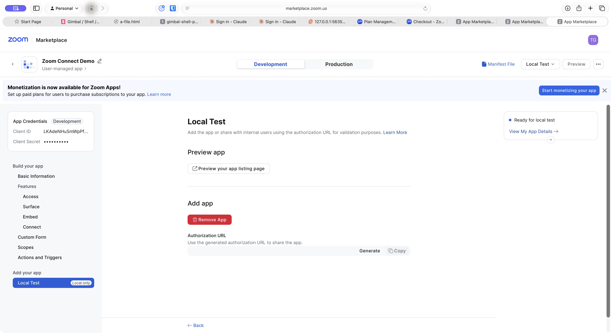

Under the Zoom web portal's **Settings → Zoom Apps**, verify **Share realtime meeting content with apps** is on. **Apps that access content in meetings** showed **Zoom Connect Demo**, auto-start **Owned & external**, and permissions **Always ask**. These were already present after installation; the agent did not change account-level sharing permissions.

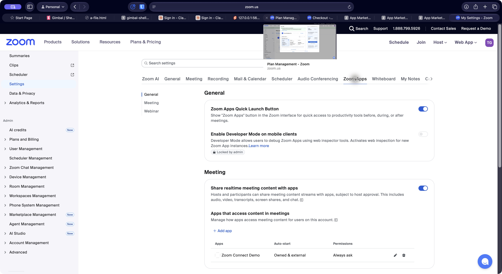

## 6. The real meeting test

The user signed into the same Zoom account on a different laptop, started a solo meeting with computer audio, and spoke. The recorder on this computer received a signed `meeting.rtms_started` webhook, completed the signaling/transcript/chat handshakes, and received transcript packets attributed to **Tyler Gannon**. The user also reported seeing Zoom Connect Demo's indicator in the meeting.

The web view displayed the actual words **“Okay, so I have started a call.”** and **“to the call. Are you still there, by the way?”**, with the speaker name and timestamps. It followed subsequent speech live. The user accepted this as a successful test.

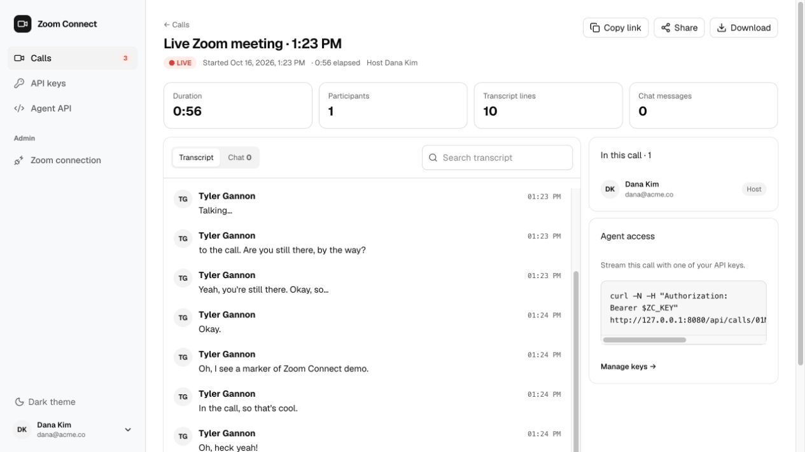

Local proof URL: http://127.0.0.1:8080/calls/01M532Q1J51XZP30JHHAJRR42C

## Storage and evidence boundaries

- Postgres: users, hashed API keys, sessions, call index, participants, shares, settings, and one `call_events` row per normalized transcript/chat/lifecycle event.
- The original `data-live/calls/<call-id>.jsonl` files remain untouched backups after the one-time import. New normalized events are database-only.
- Raw Zoom webhook/signaling/media messages: ignored `recordings/` directory.
- The bridge reuses the existing authenticated prototype APIs and marks calls as source `zoom`; scripted transcript generators are excluded from these calls, including after web-app restart.
- The displayed viewer/host identity is still the prototype account. Speaker attribution in transcript lines is real Zoom data. Real participant-to-user matching is not implemented.
- Public chat handshakes succeeded, but a public chat message was not demonstrated. End-of-call archiving, reconnect recovery, audio, video and screen-share capture were not demonstrated.
- The recorder's broad metadata subscription received an `Invalid event type` response; transcript delivery continued. Participant metadata needs a targeted follow-up before claiming it works.
- R2 is not implemented. The user subsequently authorized the Postgres event migration; it is running locally. The standalone recorder still writes raw protocol diagnostics, which are separate from application event persistence.
- Go tests passed across the repository. `vp run check` passed with zero errors and zero warnings after installing frontend dependencies locally.

## 7. Postgres event migration

The upgrade applies the idempotent event schema at startup, imports each legacy
archive transactionally, and clears its `calls.event_path` marker only after
successful import. Stop the previous web process before running the upgraded
binary. The recorder and public tunnel can remain running during this short
web-app restart. No Zoom Marketplace changes are needed.

At the local cutover, all 53 original real Zoom events were identical through
the upgraded API. Postgres contained 54 contiguous event rows for that call:
one subsequent real Zoom event had already arrived through the same recorder.
The transcript download retained its speaker attribution. See
[database proof](database-proof.json).

Integration tests exercised two concurrent SSE readers, concurrent writes,
a real database constraint rejection returning HTTP 500 without publishing or
advancing sequence, a fresh server replay, Last-Event-ID resume, transcript
download, and atomic/idempotent import with the original file removed. Go tests
and the frontend check passed. Current live subscriptions require one app
instance; multi-instance fanout is not implemented.


## 8. Supabase, Doppler and Fly deployment

Public application: https://zoom-connect-tpg-demo.fly.dev/

Sign in as `tyler@tylergannon.com` using `DEMO_LOGIN_PASSWORD` in Doppler
`zoom-connect / prd`. The deployed app disables the simulated persona routes.
The hosted database starts empty: Tyler explicitly declined copying old calls.

Supabase Free project `zoom-connect-demo` (`yalpdecithndviofygkz`) belongs to
Diffusion-TPG in us-east-1. Data API is disabled. The application uses the
session pooler at `aws-0-us-east-1.pooler.supabase.com:5432`, database `postgres`,
user `postgres.yalpdecithndviofygkz`. Build the URL with a percent-encoded
password and `sslmode=verify-full`; store the official Supabase root PEM as
`DATABASE_CA_CERT`. `DATABASE_URL` references `SUPABASE_DATABASE_URL` in Doppler.
Keep the database password only in Doppler.

All runtime secrets are in the existing Doppler config, including the configured
login, recorder API key, database connection and Zoom credentials. Fly holds only
a read-only Doppler service token scoped to this config. The temporary token
`fly-text-demo` expires 24 hours after creation on October 16: replace it before
restarting after that expiry if the demo is retained. The running processes keep
their loaded configuration until restart.

```sh
ORIGIN=https://zoom-connect-tpg-demo.fly.dev ./deploy/build.sh
docker build --platform linux/amd64 -t zoom-connect-tpg-demo:local .
fly deploy --local-only --ha=false --yes --config fly.toml
```

The Docker build context permits only the prebuilt Linux binaries and startup
script. The container runs the Go app on port 8080 and recorder on loopback 8081.
`/zoom/webhook` proxies to the recorder with the signed request unchanged.
`/healthz` checks Postgres and recorder availability. Either process exiting
stops its companion so Fly restarts the pair. Normalized events remain in
Postgres; raw recorder protocol diagnostics are ephemeral container files.
One Fly machine is intentional because live SSE fanout is currently in-process.

Verified: deployed HTTPS login and session, rejection of anonymous access and
wrong passwords, disabled simulated login, fresh hosted database, and signed
webhook endpoint validation. See [Fly proof](fly-proof.json).

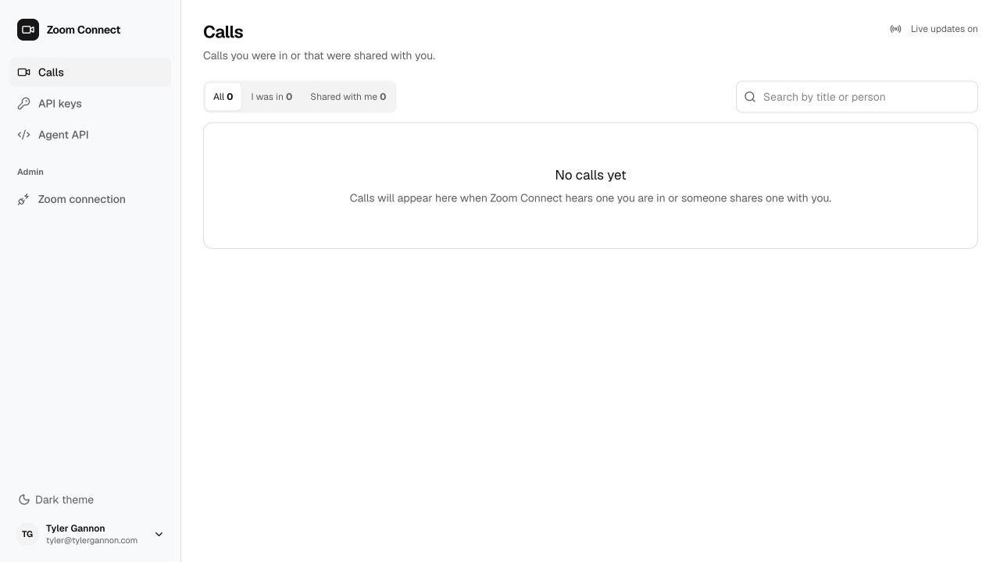

## 9. Separate production Zoom registration

The original Zoom Connect Demo app and quick-tunnel URLs remain unchanged.
Created a second user-managed General App named **Zoom Connect Production**,
app ID `LIt3ti3IQ-KbHXMIhz4x3A`. This is a separate development registration
for this account's hosted demo; it is not a publicly reviewed Marketplace release.

Repeat sections 3 and 5 on this registration, using:

- OAuth redirect and allow list: `https://zoom-connect-tpg-demo.fly.dev/healthz`.
- Webhook subscription **Zoom Connect Fly**:
  `https://zoom-connect-tpg-demo.fly.dev/zoom/webhook`.
- The same three meeting RTMS lifecycle events and transcript/chat scopes,
  with Zoom's required audio dependency.
- Meetings surface and startup recommendations for owned/external meetings.

Copy this registration's Client ID, Client Secret and Secret Token into Doppler
`prd` only. Preserve local `.env` values. Restart Fly to reload Doppler:

```sh
fly machine restart 8d99909f12d0d8 --app zoom-connect-tpg-demo
```

The restarted Fly endpoint validated this new app's HMAC challenge successfully.
Installation is currently awaiting Tyler's action-time approval at **Allow**.
After installation, verify **Remove App**, then start a meeting on the same Zoom
account, approve content sharing and speak. Verify actual speech in the hosted
call view before claiming end-to-end production capture. Local success alone is
not evidence that the deployed stream works.

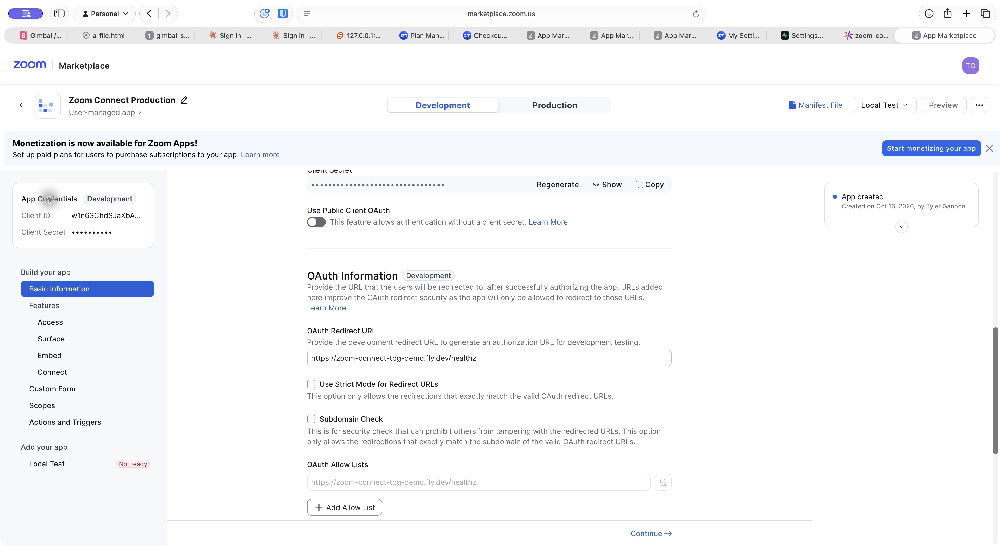
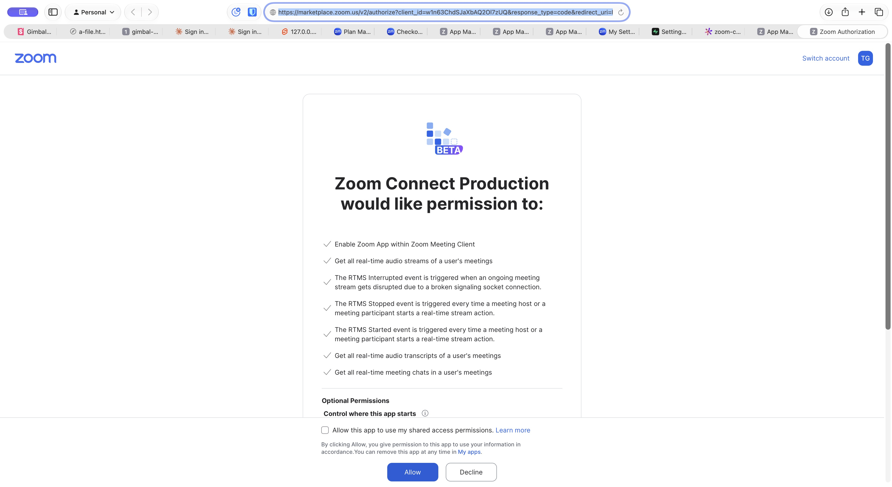

For teardown, remove the production Zoom app from the account, revoke its
Doppler service token, and destroy the Fly app when Tyler requests removal.
Supabase/Doppler deletion is separate; preserve anything still needed by the
media and scheduling tasks. No teardown was performed in this setup.
